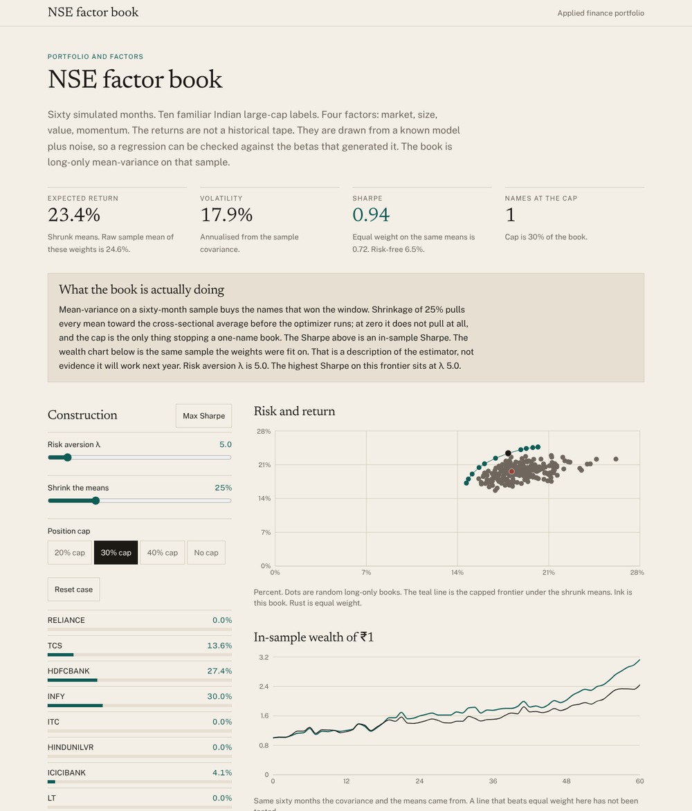

# NSE factor book

A long-only mean-variance book on a simulated panel of ten Indian large-cap names, with a four-factor regression checked against the betas that generated the data. Everything is computed live in the browser.



**Live:** _add your deployment URL here_ · **Author:** Tanmay Vaswani

## What it does

Sixty months of returns are drawn from a known four-factor model (market, size, value, momentum) plus idiosyncratic noise, for ten familiar NSE tickers. Because the data-generating betas are known, the page can show what sixty months of OLS can and cannot recover. On that sample it then builds a long-only portfolio.

- **Construction controls:** risk aversion λ, shrinkage of the sample means toward the cross-sectional average, and a position cap (20%, 30%, 40% or none). A "Max Sharpe" button jumps to the highest-Sharpe point on the frontier.
- **Risk and return:** the capped efficient frontier, a cloud of random long-only books, the current book and equal weight, all on one chart.
- **In-sample wealth of ₹1:** the optimised book against equal weight over the same sixty months, labelled for what it is.
- **Does the regression recover the market beta?** Estimated against known beta for every name.
- **One name:** the full regression table (alpha, four betas, standard errors, t-statistics, known values).
- **The ten names** and their correlation matrix.

Base case (30% cap, 25% shrinkage, λ at max Sharpe): 23.4% expected return, 17.9% volatility, in-sample Sharpe 0.94 against 0.72 for equal weight.

## Method

- Each month, four correlated factor premia are drawn (Cholesky of a fixed correlation matrix). Each name returns the risk-free rate plus alpha, plus its betas times the premia, plus Gaussian noise.
- OLS with an intercept on excess returns; standard errors assume spherical residuals. Annual means are monthly means times twelve; the covariance is the sample covariance times twelve.
- The optimiser maximises w′μ − (λ/2) w′Σw on the probability simplex with an optional upper bound, by projected gradient ascent with backtracking. The projection onto the capped simplex is exact (bisection on the Lagrange multiplier).
- Shrinkage replaces each sample mean μᵢ with (1 − a)·μᵢ + a·μ̄. The frontier is the same problem on a grid of twelve λ values. Sharpe uses a 6.5% risk-free rate.

The page is explicit that the Sharpe is in-sample, that the wealth chart is the sample the weights were fit on, and that the tickers are labels on simulated series, not a downloaded NSE tape.

## What is deliberately left out

Out-of-sample testing, transaction costs, a covariance shrinkage estimator (only the means are shrunk), heteroskedasticity-robust standard errors, and real market data. Each would be a reasonable next step and none is pretended to be there.

## Checks

`npm test` runs 37 assertions, including: the panel is reproducible from its seed; means and vols annualise correctly; the covariance is symmetric and the correlation matrix has a unit diagonal; OLS recovers every market beta within sampling error with a significant market loading; portfolio return, volatility and Sharpe follow from the inputs; optimised weights are feasible, never worse than the equal-weight start, and take less risk as λ rises; the max-Sharpe point lies on the frontier; and the normal CDF matches double-precision reference values to 12 digits.

## Run it locally

```bash
npm install
npm run dev        # http://localhost:5173
npm test           # vitest
npm run build      # typecheck + static build into dist/
```

Requires Node 20 or newer.

## Deploy

The build is a static site (`dist/`) with relative asset paths, so it works on Vercel, Netlify, Cloudflare Pages or GitHub Pages with no configuration beyond "build command `npm run build`, output directory `dist`".

## Stack

React 19, TypeScript (strict, `noUncheckedIndexedAccess`), Vite, Tailwind CSS 4, Recharts, Vitest. The numerical kit (seeded PRNG, Cholesky, OLS with a Gauss–Jordan inverse, capped-simplex projection) is in `src/lib/stats.ts` with no dependencies.

## Data

Every number on the page is synthetic, seeded and computed in the browser. Nothing here is investment advice, a forecast or a solicitation.

## License

MIT
